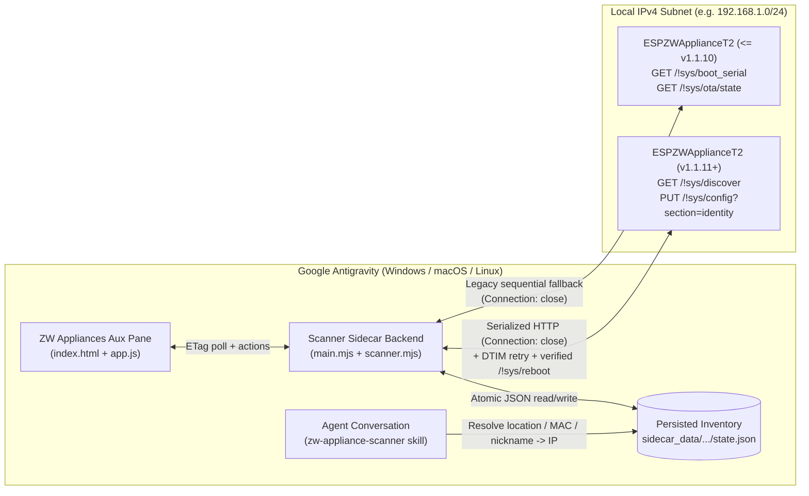

# Antigravity-ZWAppsScanner

An Auxiliary Side Pane (**ZW Appliances**), ESP8266-safe subnet discovery engine, and agent skill for developing, deploying, and managing [**`ESPZWApplianceT2`**](https://github.com/Adam5Wu/ESPZWApplianceT2)-based microcontroller appliances in **Google Antigravity**.

---

## Why This Exists

Developing and maintaining multiple Wi-Fi microcontroller appliances built on [`ESPZWApplianceT2`](https://github.com/Adam5Wu/ESPZWApplianceT2) (such as [`TWiLight`](https://github.com/Adam5Wu/TWiLight) or [`ESPClockMovementMod`](https://github.com/Adam5Wu/ESPClockMovementMod)) across a local subnet runs into several day-to-day friction points:

1. **Dynamic DHCP Leases & Mixed Firmware Fleets**: Appliances move across DHCP addresses over time and run a mix of newer (`v1.1.11+` with `/!sys/discover`) and older (`<= v1.1.10`) middleware builds. Tracking which IP corresponds to which physical unit, firmware build, or staged OTA slot by hand quickly gets stale.
2. **ESP8266 lwIP & Modem-Sleep Constraints**: Aggressive generic network scanners open concurrent HTTP keep-alive connections per IP (exhausting scarce ESP8266 lwIP sockets), miss devices resting in `WIFI_PS_MIN_MODEM` DTIM beacon sleep (up to ~`550 ms` first-packet wakeup latency), or accidentally hit endpoints like `/!sys/prov/sta.aplist` that trigger blocking active Wi-Fi scans on the MCU.
3. **Agentic Deployment Context**: When asking an AI agent in Antigravity to *"push the updated web UI to the desk lamp"* or *"check which devices are still on `v1.1.10`"*, the agent needs an up-to-date local inventory mapping human locations, hostnames, MAC addresses, and nicknames to live IPv4 addresses and `boot_serial` tokens.

**Antigravity-ZWAppsScanner** packages all three into a zero-dependency Antigravity plugin:

- **1. `ZW Appliances` Auxiliary Side Pane ([`sidecars/scanner/`](sidecars/scanner/) + [`plugin.json`](plugin.json))**: Compact Light/Dark theme-synced panel inside Antigravity with auto-detected `/24` LAN defaults, dual-action `Refresh` / `Re-scan`, smart background & exponential offline polling, inline local nickname & on-device location editing, 1-click Web UI (`/`) and `/config/` openers, and two-step `boot_serial`-verified reboots.
- **2. Mixed-Fleet ESP8266 Discovery Engine & CLI ([`sidecars/scanner/scanner.mjs`](sidecars/scanner/scanner.mjs))**: Pure Node.js ESM module (`0` external npm packages) that sweeps a `/24` subnet in ~`1.5–2.5s` (`32` workers across distinct IPs, strictly serialized `Connection: close` per IP, `750 ms` timeout + `1` DTIM wakeup retry), supporting both `v1.1.11+` (`GET /!sys/discover` with hardware MAC reconciliation across DHCP changes) and `<= v1.1.10` (`GET /!sys/boot_serial` + `GET /!sys/ota/state`).
- **3. Bundled Agent Skill ([`skills/zw-appliance-scanner/SKILL.md`](skills/zw-appliance-scanner/SKILL.md))**: Teaches Antigravity agents how to open the `[ZW Appliances](sidecar://esp-zw-app-scanner/scanner/)` panel, resolve device locations/hostnames/MACs/nicknames from persisted `state.json`, run CLI scans when needed, and follow `ESPZWApplianceT2` HTTP safety rules.

---

## Architecture



---

## Prerequisites

- **Google Antigravity** on **Windows**, **macOS**, or **Linux** (provides the Auxiliary Side Pane host and built-in Node.js sidecar runtime — no separate Node.js installation required for the UI panel).
- *(Optional, for standalone terminal CLI usage)* **Node.js 18+** on `PATH` (or Antigravity's built-in `%APPDATA%\Antigravity\bin\agy-node.cmd` shim on Windows).
- One or more [**`ESPZWApplianceT2`**](https://github.com/Adam5Wu/ESPZWApplianceT2)-based ESP8266 appliances reachable over HTTP (port `80`) on a local IPv4 `/24` subnet.

---

## Installation

### Option A: Clone Directly into Antigravity Plugins (Recommended — Cross-Platform)

**macOS / Linux (`bash` / `zsh`):**

```bash
git clone https://github.com/Adam5Wu/Antigravity-ZWAppsScanner.git \
  "$HOME/.gemini/config/plugins/esp-zw-app-scanner"
```

**Windows (`PowerShell`):**

```powershell
git clone https://github.com/Adam5Wu/Antigravity-ZWAppsScanner.git "$HOME\.gemini\config\plugins\esp-zw-app-scanner"
```

Antigravity automatically discovers `plugin.json`, launches the **ZW Appliances** sidecar (`sidecars/scanner/`), and exposes the **`zw-appliance-scanner`** skill (`skills/zw-appliance-scanner/SKILL.md`) to your agents.

### Option B: Checkout Elsewhere + Install via `Register-Plugin.ps1` (Windows)

If you keep the repository in a separate directory (e.g. `Documents\GitHub\Antigravity-ZWAppsScanner`), sync a self-contained bundle into `$HOME\.gemini\config\plugins\esp-zw-app-scanner`:

```powershell
powershell -ExecutionPolicy Bypass -File .\Register-Plugin.ps1
```

*(Pass `-LinkSource` during active development in a worktree to point the registered sidecar directly at your checkout's `sidecars/scanner/main.mjs`.)*

---

## Usage in Antigravity & CLI

### 1. Opening the `ZW Appliances` Side Panel

- Click **`+`** in the Antigravity **Auxiliary Side Pane** header → **ZW Appliances** (or ask the agent to *"Open the ZW Appliances side panel"*, which surfaces a one-click `[ZW Appliances](sidecar://esp-zw-app-scanner/scanner/)` pill).
- On first launch, the subnet prefix automatically defaults to your host's primary private IPv4 `/24` LAN (or `192.168.1` if none is detected). Adjust the prefix or host octet bounds if your IoT devices live on a separate VLAN/subnet, then click **Scan**.

| UI Control | Behavior |
| :--- | :--- |
| **Range Bar (`prefix . start – end`)** | Edit `/24` prefix and start/end octets (`1–254`). Supports **mouse wheel** (`±1`, or `Shift + Wheel` for `±10`), **clipboard paste** (`192.168.1.32-127`, `192.168.1.0/24`, `192.168.1.50`), and 1-click **`All`** reset when narrowed. |
| **`Scan` / `Refresh` / `Re-scan`** | Shows **`Scan`** when no devices are listed. Once entries exist, becomes **`Refresh`**: **1st click** starts a `1.5s` countdown bar (`Re-scan`) and re-probes known entries when the timer finishes; **2nd click** before timeout triggers a full subnet/range sweep (`Esc` cancels). |
| **Background & Offline Polling** | Refreshes listed entries on panel open and every **5 minutes**. Newly offline devices are individually polled every **`7s`** in minute 1, doubling each minute (`14s` → `28s` → `56s` → `112s`) until handing back to the 5-minute cycle. |
| **Hostname / Local Nickname** | Displays `Host name: <hostname>` on `v1.1.11+` devices (or `Set nickname…` on legacy devices). Click to set a local nickname — automatically indexed by hardware MAC on `v1.1.11+` so nicknames follow appliances across DHCP IP changes. |
| **Location Pin (`v1.1.11+`)** | Inline `Set location…` / colored pin button next to the title. Click while online to persist `{ "location" }` (`<= 64` UTF-8 bytes) directly to `/storage/app_config.json` on the MCU via `PUT /!sys/config?section=identity`. |
| **Status + IP Pill (`↗`)** | Shows live probe RTT (`<latency>ms`), `Rebooting…`, or `Offline` alongside the device IP; clicking opens `http://<ip>/` in your default system browser. |
| **`Configure`** | Opens the appliance's system management UI (`http://<ip>/config/`) in your default browser. |
| **Two-Step `Reboot` → `Confirm`** | **1st click** queries a fresh `/!sys/boot_serial` token and arms **`Confirm`** with a `1.5s` withdrawing bar; **2nd click** sends `GET /!sys/reboot?bs=<serial>` and polls until a **new** `boot_serial` comes online, refreshing firmware metadata automatically. |

---

### 2. Standalone CLI Subnet Scanner (`scanner.mjs`)

`sidecars/scanner/scanner.mjs` has zero external dependencies and can be invoked directly with Node.js from any terminal or script:

```bash
# Scan auto-detected local /24 subnet (1-254)
node sidecars/scanner/scanner.mjs

# Scan a specific CIDR, octet range, or single IP
node sidecars/scanner/scanner.mjs 192.168.1.0/24
node sidecars/scanner/scanner.mjs 192.168.1.32-127
node sidecars/scanner/scanner.mjs 192.168.1.50
```

Emits structured JSON to `stdout`:

```json
{
  "scanConfig": { "prefix": "192.168.1", "start": 32, "end": 127 },
  "count": 1,
  "elapsedMs": 812,
  "devices": [
    {
      "ip": "192.168.1.50",
      "online": true,
      "isZw": true,
      "supportsDiscover": true,
      "bootSerial": "9F2C41A0",
      "mac": "AA:BB:CC:11:22:33",
      "hostname": "TWiLight-112233",
      "location": "Office Desk",
      "project": "TWiLight",
      "version": "1.2.0",
      "buildTime": "Nov 15 2026 18:30:00",
      "latencyMs": 18,
      "lastSeenAt": "2026-11-15T10:30:00.000Z"
    }
  ]
}
```

#### Optional Environment Overrides

| Variable | Purpose | Default |
| :--- | :--- | :--- |
| `ZWAPPS_SCANNER_DATA_DIR` | Override directory for persisted `state.json` | `ANTIGRAVITY_EXECUTABLE_DATA_DIR` or `~/.gemini/antigravity/sidecar_data/esp-zw-app-scanner/scanner/data` |

---

### 3. `ESPZWApplianceT2` Firmware Compatibility

| Firmware Version | Discovery Path | Supported Capabilities |
| :--- | :--- | :--- |
| **`ESPZWApplianceT2 v1.1.11+`** | Single `GET /!sys/discover` | Fast 1-request discovery, hardware `mac` tracking across DHCP IP changes, MAC-bound local nicknames, `hostname` display, inline on-device `location` editing (`PUT /!sys/config?section=identity`), and verified reboot. |
| **Legacy (`<= v1.1.10`)** | `GET /!sys/boot_serial` → `GET /!sys/ota/state` *(→ `<title>` fallback if `403`)* | Firmware project/version/build timestamp, staged OTA `next:` badge when an alternate slot is pending reboot, IP-bound local nicknames, Web UI links, and verified reboot. |

---

## Repository Layout

```text
Antigravity-ZWAppsScanner/
├── plugin.json                        # Antigravity plugin manifest (`esp-zw-app-scanner`)
├── Register-Plugin.ps1                # PowerShell installer for external checkouts (Windows)
├── LICENSE                            # MIT License
├── assets/
│   └── logo.svg                       # Plugin icon
├── sidecars/
│   └── scanner/                       # Antigravity Auxiliary Side Pane web UI, sidecar & CLI
│       ├── package.json
│       ├── sidecar.json
│       ├── main.mjs                   # Sidecar HTTP backend, state persistence & polling timers
│       ├── scanner.mjs                # Zero-dependency ESPZWApplianceT2 subnet probe & CLI
│       ├── index.html
│       ├── styles.css
│       └── app.js
└── skills/
    └── zw-appliance-scanner/
        └── SKILL.md                   # Bundled Antigravity skill for agentic appliance workflows
```

---

## License

Released under the [MIT License](LICENSE).
